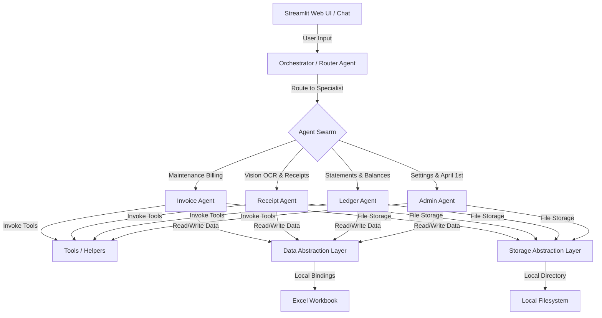
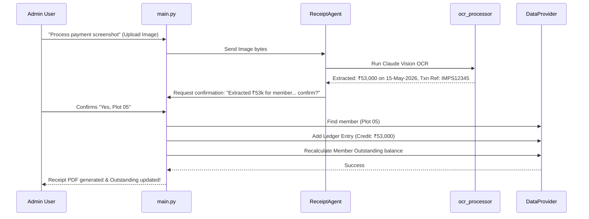

# 🏗️ Architecture & Design Document: Society Management AI Platform

This document describes the architectural patterns, modular design, and data flows of the **Society Management AI Platform**—a conversational web application built with Streamlit, LangChain, and Claude.

---

## 🧭 High-Level Overview

The system is designed to automate housing society operations (maintenance invoicing, payment tracking, ledger management, and communications) through a natural-language chat interface. Rather than running complex operations through rigid button menus, the platform delegates tasks to a **team of specialized AI agents** that run calculations, extract data from documents, and update the ledger.



---

## 🏛️ Core Design Patterns

The architecture is built on three pillars: **separation of concerns, database/storage independence, and robust AI tool-calling boundaries.**

### 1. The Abstraction Layer Pattern (Database & Storage Independence)
To ensure the application can scale from a local desktop app to a cloud-based multi-user web app, the database and storage services are decoupled from the core business logic.
* **`DataProvider` Interface**: Defines operations for fetching/updating members, recording ledger entries, checking for duplicate voucher entries, and updating system configurations.
* **`FileStorage` Interface**: Defines operations for saving, retrieving, and checking documents (such as invoices and receipt PDFs).
* **Local Excel Bindings (`LocalExcelDataProvider`)**: Implements the `DataProvider` using `openpyxl` and `pandas` against `data/society_data.xlsx`. 
* **Seamless Cloud Migration**: All agents and utilities interact *only* with the abstract interfaces. Swapping the local Excel backend for a Google Sheets database or Google Drive storage requires modifying just two lines in `config.py`.

### 2. Multi-Agent Orchestration (Router + Specialists)
The conversation uses a **Chain of Responsibility** pattern implemented via LangChain:
* **The Orchestrator**: Inspects the user's chat input and determines which domain it belongs to.
* **Specialist Agents**:
  * **Invoice Agent**: Manages monthly/annual maintenance runs and line-item charges.
  * **Receipt Agent**: Processes transaction screenshots, performs OCR, and handles payment inputs.
  * **Ledger Agent**: Handles balance sheets, voucher audits, and exports.
  * **Admin Agent**: Triggers automated entries (e.g., April 1st contributions) and manages user rates.
* Each agent operates under a tailored system prompt, equipped with a subset of tools bound to the abstract providers.

### 3. File Modification-Time Invalidation Cache
Because users may open and edit the `society_data.xlsx` workbook directly outside the application, the `LocalExcelDataProvider` implements an auto-invalidation mechanism:
* Upon every read, it checks `os.path.getmtime()` of the database file.
* If the modification time changes, the internal memory cache is invalidated and the sheet is re-read from disk immediately, preventing stale data writes.

---

## 📂 Modularity & Directory Structure

The repository is divided into highly decoupled modules:

```
society-chatbot/
├── main.py                    # Streamlit UI, Page layouts, Chat loop, and top-level callbacks
├── config.py                  # Global settings, file path definitions, and provider factories
│
├── agents/                    # AI Swarm
│   ├── base_agent.py          # Abstract LangChain wrapper with custom execution settings
│   ├── orchestrator_agent.py  # Primary dispatcher, keyword routing, and tool registries
│   ├── invoice_agent.py       # Billing calculators and maintenance algorithms
│   ├── receipt_agent.py       # Payment processing OCR loops
│   ├── ledger_agent.py        # Statement displays and accounting rules
│   └── admin_agent.py         # Member configuration and settings management
│
├── data_providers/            # Data Access Layer (DAL)
│   ├── base_provider.py       # Abstract BaseProvider contract
│   ├── local_excel_provider.py# Concrete spreadsheet implementation using openpyxl & pandas
│   └── google_sheets_provider.py# Stub ready for cloud spreadsheet bindings
│
├── file_storage/              # File Persistence Layer
│   ├── base_storage.py        # Abstract BaseStorage contract
│   ├── local_storage.py       # Concrete disk directories implementation
│   └── google_drive_storage.py# Stub ready for cloud storage integrations
│
├── tools/                     # System Tools (Bound to Agents)
│   ├── excel_processor.py     # Cell template loaders and sheet utilities
│   ├── pdf_generator.py       # ReportLab canvas bindings for invoice & receipt layouts
│   ├── pdf_parser.py          # Bank statement string extraction
│   ├── ocr_processor.py       # Claude Vision OCR parser for payment confirmations
│   └── converters.py          # Indian Rupee number-to-words, dates, and FY string mappings
│
├── utils/                     # Plumbing & Shared Helpers
│   ├── email_sender.py        # SMTPLib email sender with HTML formatting templates
│   ├── whatsapp.py            # wa.me link generation and clipboard staging
│   ├── matching.py            # Token-overlap and N-gram calculations (Path A/B deduplication)
│   └── auth.py                # Admin session credentials check
│
└── tests/                     # Test Suite (130+ cases)
    ├── test_agents.py         # Unit tests for core data/file providers and utils
    └── test_comprehensive.py  # Integration tests for ledger, OCR, and reconciliation
```

---

## 🔄 Detailed Data Flows

### 1. Payment Verification Flow (OCR to Ledger)


### 2. Auto-Split Workflow
When a payment is received for a member with a registered joint-ownership split rule (e.g., Plot 05 has joint owners A and B):
1. **Validation**: The platform detects the split rule and the total payment amount.
2. **Rollback Parent**: The system pops/removes the full-amount credit entry for the primary member to prevent over-crediting.
3. **Split Contributions**: It inserts equal `per_head` credits across all joint owner ledgers (including the source owner).
4. **Voucher Tracing**: Each split entry is registered with the description format: `Split from #{original_vch_no} (src:{source_member_id})`, enabling audit transparency and simple rollbacks.
5. **Receipt PDFs**: Only `per_head` receipt PDFs are generated for the members; the parent receipt is bypassed.

---

## 🛠️ Performance & Robustness Strategies

* **Refreshes Prevention**: Streamlit runs the script from top to bottom on any user action. To prevent spreadsheet re-reads on every dropdown change, the main ledger editor is wrapped in `st.form(key="pv_form")`.
* **Safe Writes**: If the Excel file is open in Excel on the host machine, write operations will raise a `PermissionError`. The system wraps all sheet saves in try-except blocks, returns `False` on lock detection, and surfaces a warning to the user rather than crashing.
* **Deduplication of Matching Heuristics**: The fuzzy matching logic is extracted to a single source of truth (`utils/matching.py`), executing N-Gram similarity checks to match partial bank statements to member names.
* **Double-Regex IMPS Parser**: Bank statements show IMPS in two common structures: Format A (`KMB / Name IMPSAB/`) and Format B (`IMPSAB/UTR/Name`). The parser scans for both to extract names cleanly.
