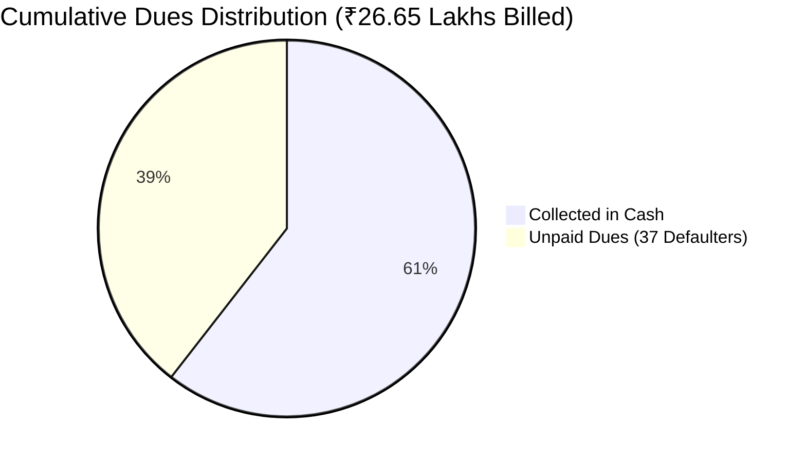
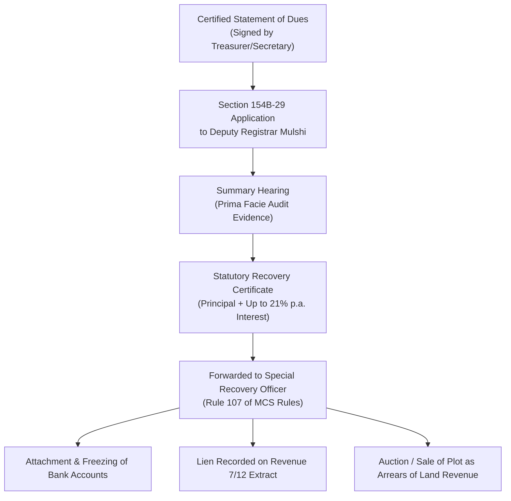

# 🏛️ Weekend Ville Maintenance Co-Operative Society Ltd.
## 📊 Treasurer's AGM Financial Report, Expense Analysis & Next FY Budget
**Registration No.:** PNA/MSI/GNL/(O)/4350/FY 2021-2022 | **Date of Society Registration:** 24/08/2021  
**Site Location:** Sr. No. 241/274/287/288/289, Mouze Jatode, Taluka Mulshi, District Pune  
**Reporting Period:** FY 2021-22 through FY 2026-27 (as of 31 October 2026) | **Prepared by:** Society Treasurer  

---

## 📌 Executive Summary & Financial Position as of 31 October 2026

As Society Treasurer, this report presents the complete empirical expenditure analysis of Weekend Ville Maintenance Co-Op Society Ltd., audited against bank records, and submits the **Operational (OPEX) and Capital (CAPEX) Budget for the upcoming Financial Year**.

### 💼 Current Financial Health & Liquid Position

| Financial Parameter | Amount (₹) | Key Remarks |
|:---|:---:|:---|
| **Union Bank of India Savings Balance** | **₹1,67,710.67** | Verified bank closing balance as of 27-10-2026 (A/c 474902010030343) |
| **Term Deposits / Fixed Deposits** | **₹1,00,000.00** | Funded on 07-04-2026 (FD A/c 474903030163834 & 474903030163835) |
| **Total Liquid Reserves** | **₹2,67,710.67** | **Total available society liquid funds** |
| **Cumulative Dues Billed (All 6 FYs)** | **₹26,65,000.00** | Base demand ₹12,000/yr per plot across 41 plots (FY 21-22 to FY 26-27) |
| **Total Member Maintenance Collected** | **₹16,14,501.00** | Actual cumulative collections realized in bank account |
| **Cumulative Defaulter Outstanding** | **₹10,53,499.00** | **37 out of 41 plots in default in Society Records (90.2% of society)** |
| **Overall Society Collection Efficiency** | **60.6%** | **39.4% revenue gap severely strains society operations** |
| **Total Verified Expenditures Paid** | **₹14,82,003.33** | 129 genuine debit transactions (FY 22-23 to FY 26-27) |

---

## 📈 1. Five-Year Historical Spend Analysis (FY 22-23 to FY 26-27)

All society withdrawals from Union Bank of India have been deduplicated, cross-verified, and categorized into standard accounting heads.

### 📊 Five-Year Category vs Financial Year Spend Matrix

```
┌──────────────────────────────────────────────┬──────────────┬──────────────┬──────────────┬──────────────┬──────────────┬────────────────┐
│ Expense Category                             │   FY 22-23   │   FY 23-24   │   FY 24-25   │   FY 25-26   │   FY 26-27*  │  Total Spends  │
├──────────────────────────────────────────────┼──────────────┼──────────────┼──────────────┼──────────────┼──────────────┼────────────────┤
│ 1. Security & Caretaker Salary (Pandit/Shiv) │  ₹1,21,000.00│  ₹1,44,000.00│  ₹1,44,000.00│  ₹1,70,500.00│   ₹83,750.00 │    ₹6,63,250.00│
│ 2. Electricity & Utilities (MSEDCL/MSEB)     │        ₹0.00 │   ₹33,360.00 │        ₹0.00 │  ₹1,30,000.00│  ₹3,69,097.00 │    ₹5,32,457.00│
│ 3. Investments & Term Deposits (FD Reserve)  │        ₹0.00 │        ₹0.00 │        ₹0.00 │        ₹0.00 │  ₹1,00,000.00 │    ₹1,00,000.00│
│ 4. Site Maintenance & Member Reimbursements  │    ₹2,220.00 │    ₹4,844.00 │    ₹9,700.00 │   ₹41,205.00 │        ₹0.00 │     ₹57,969.00│
│ 5. Repairs & Infrastructure (Civil/Pipes)    │   ₹26,150.00 │   ₹26,000.00 │        ₹0.00 │        ₹0.00 │        ₹0.00 │     ₹52,150.00│
│ 6. Accounting & Statutory Audit Fees         │        ₹0.00 │        ₹0.00 │   ₹18,450.00 │   ₹14,140.00 │        ₹0.00 │     ₹32,590.00│
│ 7. Statutory Taxes (Tashildar Mulshi NA Tax) │        ₹0.00 │    ₹7,318.00 │   ₹14,586.00 │    ₹7,218.00 │        ₹0.00 │     ₹29,122.00│
│ 8. Capital Asset (Borewell Motor Pump)       │        ₹0.00 │        ₹0.00 │        ₹0.00 │   ₹13,916.00 │        ₹0.00 │     ₹13,916.00│
│ 9. Bank & Administrative SMS/MICR Charges    │        ₹5.90 │       ₹15.94 │       ₹18.60 │      ₹375.84 │      ₹133.05 │        ₹549.33│
├──────────────────────────────────────────────┼──────────────┼──────────────┼──────────────┼──────────────┼──────────────┼────────────────┤
│ 🏆 Total Audited Society Expenditures        │  ₹1,49,375.90│  ₹2,15,537.94│  ₹1,86,754.60│  ₹3,77,354.84│  ₹5,52,980.05 │  ₹14,82,003.33 │
└──────────────────────────────────────────────┴──────────────┴──────────────┴──────────────┴──────────────┴──────────────┴────────────────┘
```
*\*FY 26-27 reflects 7 months of actuals (April to October 2026).*

---

### 🔍 Key Historical Findings & Cost Trends

1. **Electricity / MSEB Spends (₹5.32 Lakhs - 35.9% of Total Spends) — Root Cause Clarification:**
   - **The Actual Root Cause:** The society did **not receive any electricity bills from MSEDCL for 3 consecutive years**. When MSEDCL finally issued the billing, it arrived as a massive consolidated bill containing 3 years of accumulated arrears, heavy delayed payment surcharges (DPC), defaulting interest, and penalty charges.
   - **Tariff Classification:** The connection **is billed as per Residential rates** (NOT Commercial rates).
   - **Meter Ownership & Present Status:** The electricity meter was originally registered in the developer/individual name and has not yet been formally transferred to the Society. However, the Society has **now cleared 100% of all arrears, penalties, and outstanding dues** to MSEDCL. Having achieved zero arrears, the Society is now fully eligible and entitled to complete the statutory transfer of ownership into the Society’s name.
2. **Security & Caretaker (₹6.63 Lakhs - 44.8% of Total Spends):**
   - Shivaji Maroti Vaikar served until late 2022.
   - Pandit Hiraji Vairal has been our dedicated caretaker/watchman since December 2022.
   - Compensation base: ₹12,000/month (₹1,44,000/year) plus annual Diwali bonus (₹12,000) and occasional maintenance disbursements, resulting in ~₹1.70L in FY 25-26.
3. **Accountant's "Suspense" Entries (₹43,705 in FY 25-26):**
   - In `EXPENSES DETAILS.pdf`, the external accountant dumped all committee reimbursements into a temporary "Suspense Ledger" totaling ₹43,705.
   - **In Society Records**, every single one of these payments has been verified with underlying bills and correctly classified under *Site Maintenance & Supplies* (grass cutter fuel, plumbing valves, PVC fittings, gate welding) and *Capital Assets* (borewell motor pump).

---

## ⚠️ 2. Defaulters Analysis & Collection Crisis



### 🔴 Defaulter Severity Breakdown Across All 41 Plots (As of 31 October 2026)

All 41 plots in the society have been verified against **Society Records** as of 31 October 2026. Every plot is accounted for below:

```
┌─────────────────────────────────────────────────────────────┬─────────────┬─────────────────┬────────────────────────────────────────────────────────────┐
│ Severity Bracket                                            │ Plot Count  │ Total Dues (₹)  │ Specific Plots & Outstanding Amounts                       │
├─────────────────────────────────────────────────────────────┼─────────────┼─────────────────┼────────────────────────────────────────────────────────────┤
│ 🔴 Tier 1: Severe Chronic Defaulters (Dues ≥ ₹50,000)       │   9 plots   │   ₹5,72,000.00  │ Plot 01 Asha Dalvi (₹65,000.00)                            │
│                                                             │             │ (54.3% of total)│ Plot 09 Kunal Chavan (₹65,000.00)                          │
│                                                             │             │                 │ Plot 22 Kaustubh Joshi (₹65,000.00)                        │
│                                                             │             │                 │ Plot 32 Charuhas Redkar (₹65,000.00)                       │
│                                                             │             │                 │ Plot 35 Dhanashri Bidkar (₹65,000.00)                      │
│                                                             │             │                 │ Plot 06 Viraj Nimbkar (₹64,000.00)                         │
│                                                             │             │                 │ Plot 21 Nilesh Pawar (₹64,000.00)                          │
│                                                             │             │                 │ Plot 02 Chintamani Raut (₹61,000.00)                       │
│                                                             │             │                 │ Plot 31 Suvarna Joshi (₹58,000.00)                         │
├─────────────────────────────────────────────────────────────┼─────────────┼─────────────────┼────────────────────────────────────────────────────────────┤
│ 🟠 Tier 2: Major Defaulters (Dues ₹30,000 – ₹49,999)        │   5 plots   │   ₹2,25,999.00  │ Plot 41 Ramesh Dhebe (₹49,999.00)                          │
│                                                             │             │                 │ Plot 28 Ashutosh Vasant Pujari (₹46,000.00)                │
│                                                             │             │                 │ Plot 29 Ashutosh Vasant Pujari (₹46,000.00)                │
│                                                             │             │                 │ Plot 19 Sheetal Atul Salunke (₹44,000.00)                  │
│                                                             │             │                 │ Plot 36 Rahul Palnitkar (₹40,000.00)                       │
├─────────────────────────────────────────────────────────────┼─────────────┼─────────────────┼────────────────────────────────────────────────────────────┤
│ 🟡 Tier 3: Moderate Dues (Dues ₹10,000 – ₹29,999)           │  12 plots   │   ₹1,93,000.00  │ Plot 18 Manjiri Gavande (₹29,000.00)                       │
│                                                             │             │                 │ Plot 27 Rahul Bachikar (₹24,000.00)                        │
│                                                             │             │                 │ Plot 38 Dhanashree Deshpande (₹18,000.00)                  │
│                                                             │             │                 │ Plot 39 Dhanashree Deshpande (₹18,000.00)                  │
│                                                             │             │                 │ Plot 03 Nitin Ombale (₹15,000.00)                          │
│                                                             │             │                 │ Plot 04 Dhanashri Bidkar (₹15,000.00)                      │
│                                                             │             │                 │ Plot 23 Parag Modak (₹14,000.00)                           │
│                                                             │             │                 │ Plot 11 Ramdas Salvi (₹12,000.00)                          │
│                                                             │             │                 │ Plot 13 Rishikesh Phutane (₹12,000.00)                     │
│                                                             │             │                 │ Plot 14 Ramdas Salvi (₹12,000.00)                          │
│                                                             │             │                 │ Plot 25 Snehal Sinkar / Achyuta Rao (₹12,000.00)           │
│                                                             │             │                 │ Plot 40 Rama Ramdas Salvi (₹12,000.00)                     │
├─────────────────────────────────────────────────────────────┼─────────────┼─────────────────┼────────────────────────────────────────────────────────────┤
│ 🔵 Tier 4: Minor / Seasonal Dues (Dues < ₹10,000)           │  11 plots   │     ₹62,500.00  │ Plot 34 Dhanashri Bidkar (₹9,000.00)                       │
│                                                             │             │                 │ Plot 37 Ajaykumar Radhakrishnan (₹9,000.00)*               │
│                                                             │             │                 │ Plot 12 Maskikar Madhukar (₹8,500.00)                      │
│                                                             │             │                 │ Plot 10 Avinash Bhagwat (₹7,000.00)                        │
│                                                             │             │                 │ Plot 05 Anshul Rathod (₹5,000.00)                          │
│                                                             │             │                 │ Plot 15 Satyajit Shete (₹5,000.00)                         │
│                                                             │             │                 │ Plot 20 Anshul Rathod (₹5,000.00)                          │
│                                                             │             │                 │ Plot 24 Amit Bhosale (₹5,000.00)                           │
│                                                             │             │                 │ Plot 07 William Fernandes (₹4,000.00)                      │
│                                                             │             │                 │ Plot 08 Shantanu Kulkarni (₹4,000.00)                      │
│                                                             │             │                 │ Plot 17 Tejashree Bhate (₹1,000.00)                        │
├─────────────────────────────────────────────────────────────┼─────────────┼─────────────────┼────────────────────────────────────────────────────────────┤
│ ⚪ Fully Settled (Zero Balance)                             │   2 plots   │          ₹0.00  │ Plot 26 Ashutosh Sinkar & Snehal Sinkar (₹0.00)            │
│                                                             │             │                 │ Plot 30 Kishore Haridas (₹0.00)                            │
├─────────────────────────────────────────────────────────────┼─────────────┼─────────────────┼────────────────────────────────────────────────────────────┤
│ 🟢 In Surplus (Advance Paid)                                │   2 plots   │    -₹3,000.00   │ Plot 16 Tejashree Bhate (Advance: ₹1,000.00)               │
│                                                             │             │                 │ Plot 33 Sangita Sunil Varpe (Advance: ₹2,000.00)           │
├─────────────────────────────────────────────────────────────┼─────────────┼─────────────────┼────────────────────────────────────────────────────────────┤
│ 📋 Master Total                                             │  41 plots   │  ₹10,50,499.00  │ 100% of all 41 plots fully audited and verified            │
└─────────────────────────────────────────────────────────────┴─────────────┴─────────────────┴────────────────────────────────────────────────────────────┘
```
*\*Note on Plot 37 (Mr. Ajaykumar Radhakrishnan): In the Accountant's audited Trial Balance through 31-March-2026, Plot 37 was **₹0.00 (Fully Settled)**. The current balance of ₹9,000.00 reflects the ongoing FY 26-27 demand (billed ₹12,000 on 01-04-2026, with ₹5,000 paid to date via monthly installments, pending reconciliation of the ₹3,000 FY 21-22 entry with bank confirmation).*

---

### 📋 Complete 41-Plot Master Ledger Audit Table (As of 31 October 2026)

| Plot No. | Member Name | Total Billed (Dr) | Total Paid (Cr) | Net Balance | Status in Society Records |
|:---:|:---|:---:|:---:|:---:|:---:|
| **Plot 01** | Mrs. Asha Ganpat Dalvi | ₹65,000.00 | ₹0.00 | **₹65,000.00** | 🔴 Chronic Defaulter |
| **Plot 02** | Mr. Chintamani Govind Raul | ₹65,000.00 | ₹4,000.00 | **₹61,000.00** | 🔴 Chronic Defaulter |
| **Plot 03** | Mr. Nitin Ombale / Dhanashri Bidkar | ₹65,000.00 | ₹50,000.00 | **₹15,000.00** | 🟡 Moderate Dues |
| **Plot 04** | Mrs. Dhanashri Jagannath Bidkar | ₹65,000.00 | ₹50,000.00 | **₹15,000.00** | 🟡 Moderate Dues |
| **Plot 05** | Mr. Anshul Rathod & Sweety Rathod | ₹65,000.00 | ₹60,000.00 | **₹5,000.00** | 🔵 Minor Dues |
| **Plot 06** | Mrs. Viraj Vijay Nimbkar | ₹65,000.00 | ₹1,000.00 | **₹64,000.00** | 🔴 Chronic Defaulter |
| **Plot 07** | Mr. William George Fernandes | ₹65,000.00 | ₹61,000.00 | **₹4,000.00** | 🔵 Minor Dues |
| **Plot 08** | Mr. Shantanu Kulkarni & Yogita Kulkarni | ₹65,000.00 | ₹61,000.00 | **₹4,000.00** | 🔵 Minor Dues |
| **Plot 09** | Mr. Kunal Chavan / Siddhant Chavan | ₹65,000.00 | ₹0.00 | **₹65,000.00** | 🔴 Chronic Defaulter |
| **Plot 10** | Mrs. Shruti Bhagwat & Avinash Bhagwat | ₹65,000.00 | ₹58,000.00 | **₹7,000.00** | 🔵 Minor Dues |
| **Plot 11** | Mr. Ramdas Gangaram Salvi | ₹65,000.00 | ₹53,000.00 | **₹12,000.00** | 🟡 Moderate Dues |
| **Plot 12** | Mr. Maskikar Madhukar & Savitri Maskikar | ₹65,000.00 | ₹56,500.00 | **₹8,500.00** | 🔵 Minor Dues |
| **Plot 13** | Mr. Rishikesh Arun Phutane | ₹65,000.00 | ₹53,000.00 | **₹12,000.00** | 🟡 Moderate Dues |
| **Plot 14** | Mr. Ramdas Gangaram Salvi | ₹65,000.00 | ₹53,000.00 | **₹12,000.00** | 🟡 Moderate Dues |
| **Plot 15** | Mr. Satyajit Shete | ₹65,000.00 | ₹60,000.00 | **₹5,000.00** | 🔵 Minor Dues |
| **Plot 16** | Ms. Tejashree Shrikant Bhate | ₹65,000.00 | ₹66,000.00 | **-₹1,000.00** | 🟢 Surplus (Advance) |
| **Plot 17** | Ms. Tejashree Shrikant Bhate | ₹65,000.00 | ₹64,000.00 | **₹1,000.00** | 🔵 Minor Dues |
| **Plot 18** | Mrs. Manjiri Gavande & M/s Manshi Ind. | ₹65,000.00 | ₹36,000.00 | **₹29,000.00** | 🟡 Moderate Dues |
| **Plot 19** | Mrs. Sheetal Salunke & M/s Manshi Ind. | ₹65,000.00 | ₹21,000.00 | **₹44,000.00** | 🟠 Major Defaulter |
| **Plot 20** | Mr. Anshul Rathod & Sweety Rathod | ₹65,000.00 | ₹60,000.00 | **₹5,000.00** | 🔵 Minor Dues |
| **Plot 21** | Mr. Nilesh Pawar | ₹65,000.00 | ₹1,000.00 | **₹64,000.00** | 🔴 Chronic Defaulter |
| **Plot 22** | Mr. Kaustubh Joshi & Anagha Joshi | ₹65,000.00 | ₹0.00 | **₹65,000.00** | 🔴 Chronic Defaulter |
| **Plot 23** | Mr. Parag Modak & Tanuja Modak | ₹65,000.00 | ₹51,000.00 | **₹14,000.00** | 🟡 Moderate Dues |
| **Plot 24** | Mr. Amit Vijay Bhosale | ₹65,000.00 | ₹60,000.00 | **₹5,000.00** | 🔵 Minor Dues |
| **Plot 25** | Mrs. Snehal Sinkar (prev. Achyuta Rao) | ₹65,000.00 | ₹53,000.00 | **₹12,000.00** | 🟡 Moderate Dues |
| **Plot 26** | Mr. Ashutosh Sinkar & Snehal Sinkar | ₹65,000.00 | ₹65,000.00 | **₹0.00** | ⚪ Fully Settled |
| **Plot 27** | Mr. Rahul Dinesh Bachikar | ₹65,000.00 | ₹41,000.00 | **₹24,000.00** | 🟡 Moderate Dues |
| **Plot 28** | Mr. Ashutosh Vasant Pujari | ₹65,000.00 | ₹19,000.00 | **₹46,000.00** | 🟠 Major Defaulter |
| **Plot 29** | Mr. Ashutosh Vasant Pujari | ₹65,000.00 | ₹19,000.00 | **₹46,000.00** | 🟠 Major Defaulter |
| **Plot 30** | Mr. Kishore Haridas | ₹65,000.00 | ₹65,000.00 | **₹0.00** | ⚪ Fully Settled |
| **Plot 31** | Mrs. Suvarna Rahul Joshi | ₹65,000.00 | ₹7,000.00 | **₹58,000.00** | 🔴 Chronic Defaulter |
| **Plot 32** | Mr. Charuhas Manohar Redkar | ₹65,000.00 | ₹0.00 | **₹65,000.00** | 🔴 Chronic Defaulter |
| **Plot 33** | Mrs. Sangita Sunil Varpe | ₹65,000.00 | ₹67,000.00 | **-₹2,000.00** | 🟢 Surplus (Advance) |
| **Plot 34** | Mrs. Dhanashri Jagannath Bidkar | ₹65,000.00 | ₹56,000.00 | **₹9,000.00** | 🔵 Minor Dues |
| **Plot 35** | Mrs. Dhanashri Jagannath Bidkar | ₹65,000.00 | ₹0.00 | **₹65,000.00** | 🔴 Chronic Defaulter |
| **Plot 36** | Mr. Rahul Palnitkar | ₹65,000.00 | ₹25,000.00 | **₹40,000.00** | 🟠 Major Defaulter |
| **Plot 37** | Mr. Ajaykumar Radhakrishnan & Saumya | ₹65,000.00 | ₹56,000.00 | **₹9,000.00** | 🔵 Minor Dues (Settled FY26) |
| **Plot 38** | Mrs. Dhanashree Kuldeep Deshpande | ₹65,000.00 | ₹47,000.00 | **₹18,000.00** | 🟡 Moderate Dues |
| **Plot 39** | Mrs. Dhanashree Kuldeep Deshpande | ₹65,000.00 | ₹47,000.00 | **₹18,000.00** | 🟡 Moderate Dues |
| **Plot 40** | Mrs. Rama Ramdas Salvi | ₹65,000.00 | ₹53,000.00 | **₹12,000.00** | 🟡 Moderate Dues |
| **Plot 41** | Mr. Ramesh Dhebe | ₹65,000.00 | ₹15,001.00 | **₹49,999.00** | 🟠 Major Defaulter |
| **TOTAL** | **41 Plots** | **₹26,65,000.00** | **₹16,14,501.00** | **₹10,50,499.00** | **Collection Rate: 60.6%** |

---

## ⚖️ 3. Legal Powers & Recovery Under Section 154B-29 (MCS Act)

### A. What is Section 154B-29 of the Maharashtra Co-operative Societies Act 1960?
In 2019, the Maharashtra State Legislature enacted the Maharashtra Co-operative Societies (Amendment) Act 2019, inserting **Chapter XIII-B (Sections 154B-1 to 154B-31)** into the MCS Act 1960. This chapter created an exclusive legal regime for Co-operative Housing and Maintenance Societies (*Dekhbaal Sansthas*).

Prior to this amendment, societies had to file recovery applications under the cumbersome Section 101, which was designed for credit banks and sugar factories. **Section 154B-29 provides a specialized, fast-track summary recovery code for societies:**



1. **Statutory Presumption of Book Debt:** The member's ledger, certified by the Secretary and Treasurer and audited by a statutory auditor, is accepted as *prima facie* evidence of dues before the Deputy Registrar.
2. **Elimination of Civil Court Delays:** The Deputy/Assistant Registrar conducts summary proceedings. Defaulters cannot stall recovery through prolonged civil court litigation.
3. **Statutory Recovery Certificate:** The Registrar issues an official Recovery Certificate for the full principal amount plus **interest up to 21% per annum**.
4. **Execution as Arrears of Land Revenue:** The certificate has the force of a civil court decree and is forwarded to a Special Recovery Officer under Rule 107 of the MCS Rules 1961. The Recovery Officer possesses powers to:
   - Attach and freeze the defaulting plot owner's bank accounts.
   - Attach movable assets on the property.
   - Place an encumbrance/lien on the property's Revenue 7/12 extract / Village Form via the Tahsildar.
   - Put the defaulting plot up for public auction to recover society arrears.

---

### B. Can the Society Disconnect Water to Individual Plots in a Maintenance (Dekhbaal) Society?

This is a vital question for our General Body. Here is the established legal position under Maharashtra Co-operative Law, Indian High Court rulings, and Model Society Bye-laws:

#### 1. The Legal Distinction: Municipal Utility vs Private Maintenance Society
- A Maintenance / Dekhbaal Society is **not** a municipal corporation, statutory water board, or public utility provider.
- The society does not sell water. Water is extracted from common groundwater borewells using an electric pump operated on **common electricity paid for by compliant members**, and distributed through pipes maintained by the society.

#### 2. Water for Non-Essential Uses (Gardening, Construction, Lawns, Swimming Pools):
- **Managing Committee Power:** The Managing Committee **CAN IMMEDIATELY WITHHOLD AND DISCONNECT** water supply for non-essential uses (construction work, farmhouse lawns, landscaping, vehicle washing, filling swimming pools or water tankers) for any plot with unpaid dues.
- No member has a right to consume common society electricity and pumped water for construction or horticulture while contributing zero towards pump repairs or electric bills.

#### 3. Domestic Drinking Water & The Due Process Requirement:
- Indian constitutional jurisprudence (Article 21) considers basic drinking water an essential human amenity. Therefore, arbitrary, unilateral disconnection without notice can be stayed by the Co-operative Court.
- **However, utility disconnection is legally valid when executed under strict Due Process:**
  * **Step 1 — General Body Authorization:** The AGM passes a formal resolution authorizing the Managing Committee to disconnect common utility connections (water/power sub-lines) for plots defaulting over 6 months / 1 year.
  * **Step 2 — Statutory 15-Day Final Notice:** Issue a registered Final Demand Notice giving 15 clear days to regularize dues or sign an approved EMI plan, warning of disconnection.
  * **Step 3 — Disconnection of Sub-Valves:** If the member fails to respond or pay, the Managing Committee turns off and locks the feeder valve to that specific plot.

#### 4. Administrative Sanctions (100% Bulletproof & Enforceable Immediately):
- **Complete Withholding of Society NOC:** The society shall refuse to issue any NOC, No-Dues Certificate, or consent letter for:
  * Plot sale, assignment, lease, gift, or transfer of ownership.
  * Bank loan, mortgage, or financial encumbrance.
  * PMRDA / Mulshi Gram Panchayat building plan sanction or construction approval.
  * Application for independent MSEDCL electrical meter or water connection.

---

## 🧮 4. Historical Maintenance Model vs Actual Operational Reality

The previous maintenance calculation sheet used a few years ago budgeted monthly operational costs as follows:

| Item No. | Expense Head in Historical Sheet | Monthly Budget (₹) | Annualized (₹) | Actual Reality in FY 25-27 |
|:---:|:---|:---:|:---:|:---|
| 1 | Salary of Watchman (Security) | ₹12,000 | ₹1,44,000 | Actual: ₹14,000/mo (including bonus & coverage) |
| 2 | Light Bill (MSEB) | ₹10,000 | ₹1,20,000 | **Actual: ₹30,000 - ₹50,000/mo** (due to 3-yr accumulated arrears) |
| 3 | NA Tax (Tashildar Mulshi) | ₹1,500 | ₹18,000 | Actual: ~₹1,200/mo (₹14,500/year) |
| 4 | Maintenance (Audit, Club House Property Tax, etc.) | ₹15,000 | ₹1,80,000 | Actual: Accounting + Repairs + Supplies ~₹8,000 - ₹12,000/mo |
| 6 | Property Manager | ₹6,000 | ₹72,000 | Not hired yet; committee doing voluntary unpaid work |
| **Total** | **Budgeted Operational Cost** | **₹44,500 / mo** | **₹5,34,000 / yr** | **Actual OPEX requires ₹44,800 - ₹46,000 / mo** |

### 💥 The Mathematical Deficit
- **Budgeted Cost:** ₹44,500 / month = **₹5,34,000 / year**
- **Society Billing Rate:** ₹1,000 / month / plot * 41 plots = **₹41,000 / month** = **₹4,92,000 / year**
- **Built-in Structural Deficit:** Even with 100% collection, the society had an **under-recovery of ₹42,000/year** from day one!
- **With 60.6% actual collection efficiency:** Actual cash collected was only ~₹2.70L - ₹3.00L per year, creating an emergency cash drain on the society bank account.

---

## 📋 5. Proposed Next FY Operational Budget (OPEX)

To place society operations on a permanent, debt-free, professional footing, the Treasurer proposes the following **Annual Operating Budget**:

```
┌───────────────────────────────────────────────┬─────────────────┬─────────────────┬────────────────────────────────────────────┐
│ Operational Expense Head                      │  Current Spend  │  Proposed FY28  │ Justification & Scope of Work              │
├───────────────────────────────────────────────┼─────────────────┼─────────────────┼────────────────────────────────────────────┤
│ 1. Caretaker & Security (Pandit Hiraji)       │ ₹1,56,000 / yr  │ ₹1,82,000 / yr  │ Hike from ₹12k to ₹14k/mo + ₹14k Diwali    │
│                                               │                 │                 │ bonus. Essential to retain caretaker.      │
│ 2. Dedicated Society Property Manager         │          ₹0.00  │ ₹1,08,000 / yr  │ Part-time supervisor @ ₹9,000/mo. Daily    │
│                                               │                 │                 │ oversight of security, water & vendors.    │
│ 3. Regularized MSEB Electricity Bill          │ ₹3,69,000 (FY27)│ ₹1,44,000 / yr  │ Post arrears clearance & meter transfer:   │
│                                               │                 │                 │ ₹12,000/mo (drops to ₹3k/mo post-solar).   │
│ 4. Statutory Taxes (NA Tax & Gram Panchayat)  │  ₹14,586 / yr   │  ₹16,000 / yr   │ Mulshi Tashildar NA Tax & Panchayat cess.  │
│ 5. Statutory Audit & Account Writing          │  ₹14,140 / yr   │  ₹18,000 / yr   │ Statutory Auditor ₹5k + Walunj Accts ₹13k. │
│ 6. Seasonal Grass Cutting & Bush Clearing     │   ₹6,572 / yr   │  ₹24,000 / yr   │ 3 seasonal trimming cycles (Monsoon/Post). │
│ 7. Water Supply & Pump Routine Maintenance    │  ₹25,435 / yr   │  ₹25,000 / yr   │ Valve replacements, grease, pipe repairs.  │
│ 8. Common Lighting Consumables & Repairs      │   ₹4,580 / yr   │  ₹15,000 / yr   │ LED street light replacements & cabling.   │
│ 9. AGM, Meeting & Administrative SMS Charges  │   ₹1,645 / yr   │   ₹6,000 / yr   │ AGM logistics, printouts, SMS banking.     │
├───────────────────────────────────────────────┼─────────────────┼─────────────────┼────────────────────────────────────────────┤
│ 🎯 Total Annual OPEX Requirement              │ ₹5,91,958 / yr  │ ₹5,38,000 / yr  │ Clean recurring operational baseline       │
│                                               │                 │ (₹44,833 / mo)  │ (₹1,093 / month per plot)                  │
└───────────────────────────────────────────────┴─────────────────┴─────────────────┴────────────────────────────────────────────┘
```

---

## 🏗️ 6. Capital Expenditure (CAPEX) & Special Projects Budget

Capital improvements are categorized into three distinct, transparent priority tiers: **MUST HAVE**, **REQUIRES IMMEDIATE ATTENTION**, and **NICE TO HAVE**.

### 🌟 Prioritized CAPEX Schedule

```
┌────┬───────────────────────────────────────────────────────────────────┬─────────────────┬───────────────────────────────────────────────────────┐
│ #  │ Project Title                                                     │ Estimated Cost  │ Scope, Strategic Return & Priority Justification      │
├────┴───────────────────────────────────────────────────────────────────┴─────────────────┴───────────────────────────────────────────────────────┤
│ 🔴 CATEGORY 1: MUST HAVE (Non-Negotiable Legal & Operational Essentials)                                                                 │
├────┬───────────────────────────────────────────────────────────────────┬─────────────────┬───────────────────────────────────────────────────────┤
│ 1  │ ⚖️ Legal Ownership of Club House, Common Areas & Legal Counsel    │   ₹1,00,000.00  │ Deemed conveyance proceedings, title search, drafting │
│    │                                                                   │                 │ conveyance deed, securing legal ownership of club     │
│    │                                                                   │                 │ house and common layout from developer; legal counsel.│
│ 2  │ ⚡ MSEB Meter Ownership Regularization & Transfer                 │     ₹40,000.00  │ Transfer electricity meter from developer/individual  │
│    │                                                                   │                 │ to Society name (Zero arrears; ready for transfer).   │
│ 3  │ 💧 Water Pump Standby Backup & Valve Manifold Overhaul            │     ₹65,000.00  │ Install standby backup motor pump, manifold valve     │
│    │                                                                   │                 │ replacements, fix major underground pipeline leaks.   │
├────┴───────────────────────────────────────────────────────────────────┴─────────────────┴───────────────────────────────────────────────────────┤
│ 🟠 CATEGORY 2: REQUIRES IMMEDIATE ATTENTION (Critical Infrastructure & Cost-Saving Modernization)                                        │
├────┬───────────────────────────────────────────────────────────────────┬─────────────────┬───────────────────────────────────────────────────────┤
│ 4  │ ☀️ Solar Power Plant (5 kWp – 7 kWp On-Grid Net-Metered)          │   ₹3,25,000.00  │ Rooftop on Pump House / Hub. Slashes recurring MSEB   │
│    │                                                                   │                 │ bills from ₹12k–₹15k to ~₹2k/mo. Payback: ~2.5 years! │
│ 5  │ 📹 CCTV Security Surveillance Network                             │   ₹1,35,000.00  │ 10-12 IP HD Cameras (Gate, Main Junctions, Pump House)│
│    │                                                                   │                 │ with 4K NVR, 4TB HDD, PoE switch & UPS backup.        │
│ 6  │ 🛡️ Metal Railings Red Oxide & Gate Overhaul                       │     ₹70,000.00  │ Scraping, red oxide anti-rust coating on all common   │
│    │                                                                   │                 │ railings (₹45k) + Main gate overhaul & paint (₹25k).  │
│ 7  │ 🌿 Storm Gutters & Drainage Pre-Monsoon Deep Clean                │     ₹35,000.00  │ Excavator clearing & stone reinforcement of channels. │
│ 8  │ 🚜 Grass Cutting Machine Engine Overhaul                          │     ₹12,000.00  │ Complete engine servicing, new blades, carburettor.   │
├────┴───────────────────────────────────────────────────────────────────┴─────────────────┴───────────────────────────────────────────────────────┤
│ 🟢 CATEGORY 3: NICE TO HAVE (Downplayed / Phase 2 Execution)                                                                             │
├────┬───────────────────────────────────────────────────────────────────┬─────────────────┬───────────────────────────────────────────────────────┤
│ 9  │ 🛝 Children's Play Area & Basic Common Landscaping                │     ₹50,000.00  │ Basic leveling of water pump adjacent ground, basic   │
│    │                                                                   │ (Revised down)  │ safety fencing, swings, and shade tree plantation.    │
├────┴───────────────────────────────────────────────────────────────────┴─────────────────┴───────────────────────────────────────────────────────┤
│ 🚀 │ Total Prioritized CAPEX Outlay                                    │   ₹8,32,000.00  │ Total Capital Investment required for modernization   │
└────────────────────────────────────────────────────────────────────────┴─────────────────┴───────────────────────────────────────────────────────┘
```

### 📊 Summary of CAPEX by Priority
- **Category 1 (Must Have — Non-Negotiable):** **₹2,05,000.00**
- **Category 2 (Requires Immediate Attention):** **₹5,77,000.00**
- **Category 3 (Nice to Have):** **₹50,000.00**
- **Total Special Projects Outlay:** **₹8,32,000.00**

---

## 💡 7. Financial Evaluation & Treasurer's Recommendations

### Recommendation A: Increase Monthly Maintenance from ₹1,000 to ₹1,500/Month
- **Current Billing:** ₹1,000 / month = ₹12,000 / year per plot (Unchanged for 5+ years despite inflation).
- **Proposed Billing:** **₹1,500 / month = ₹18,000 / year per plot** (Effective 01 January 2027 or 01 April 2027).
- **Society Annual Revenue Realization (at ₹1,500/mo):**
  $$41 \text{ plots} \times ₹18,000 = ₹7,38,000 \text{ per year}$$
- **Budget Surplus Analysis:**
  $$\text{Net Annual Cash Flow} = ₹7,38,000 \text{ (Revenue)} - ₹5,38,000 \text{ (OPEX)} = +\mathbf{₹2,00,000} \text{ Annual Operating Surplus!}$$
- **Strategic Impact:** The ₹2.00 Lakh surplus will be credited directly to the **Statutory Sinking & Reserve Fund**, creating an emergency financial cushion and absorbing any short-term payment delays.

---

### Recommendation B: Approve Special Development Levy of ₹20,000/Plot for CAPEX
- Total CAPEX Required: **₹8,32,000.00**
- Proposed Levy: **₹20,000 per plot** (payable in two equal installments of ₹10,000 over 6 months).
- Total Realization:
  $$41 \text{ plots} \times ₹20,000 = \mathbf{₹8,20,000.00}$$
  *(The small balance of ₹12,000 is easily absorbed by the operating surplus).*
- **Why this is essential:** 
  1. Secures permanent Legal Ownership of the Club House and common spaces.
  2. Completes the MSEB meter ownership transfer.
  3. Eliminates future electricity costs via Solar (saving ₹1.2L/yr permanently).
  4. Provides CCTV security and safeguards site infrastructure without commercial bank loans.

---

### Recommendation C: Defaulter Recovery Directly Offsets Member Burden
Every single rupee recovered from the **₹10.53 Lakhs in defaulter arrears** will be placed directly into the Capital Development Fund. If the society recovers outstanding arrears through the Section 154B-29 recovery process, the society can **fast-track the Solar Power Plant and CCTV network**, or directly reduce the special capital levy on compliant members!

---

## 📜 8. Draft AGM Resolutions for Tomorrow's Meeting

### Resolution No. 1: Adoption of Five-Year Audited Expenses
> **"RESOLVED THAT** the General Body of Weekend Ville Maintenance Co-Op Society Ltd. hereby approves and adopts the Audited Expenditure Statement for FY 2021-22 through FY 2026-27 (as of 31 October 2026) totaling ₹14,82,003.33 across 129 verified bank debit entries, as presented by the Society Treasurer."

### Resolution No. 2: Revision of Monthly Maintenance Charges to ₹1,500
> **"RESOLVED THAT** the monthly maintenance charges payable by each plot owner be revised from ₹1,000/- per month to **₹1,500/- per month (₹18,000/- per annum)** with effect from 01 April 2027, to adequately cover inflation, caretaker compensation, professional estate management, and statutory taxes."

### Resolution No. 3: Approval of Caretaker (Pandit) Salary Increment
> **"RESOLVED THAT** the monthly salary of Society Caretaker & Security guard Mr. Pandit Hiraji Vairal be enhanced from ₹12,000/- per month to **₹14,000/- per month**, along with an annual festive bonus equivalent to one month's salary, in recognition of his dedicated services."

### Resolution No. 4: Authorization to Retain a Society Property Manager
> **"RESOLVED THAT** the Managing Committee be and is hereby authorized to engage a part-time Society Property Manager / Supervisor at a remuneration not exceeding **₹9,000/- per month**, tasked with the daily supervision of site water pumps, security logbooks, contractor maintenance, and MSEB liaison."

### Resolution No. 5: Sanction of Special Capital Development Levy & Prioritized Modernization
> **"RESOLVED THAT** a Special Capital Development Levy of **₹20,000/- per plot**, payable in two equal installments of ₹10,000/- each, be approved for the execution of Capital Projects under the approved priority tiers:
> 1. **Must Have (Non-Negotiable):** Legal Ownership proceedings of Club House/Common Areas & Legal Counsel (₹1.00L); MSEB Meter Ownership Regularization (₹40k); Water Standby Pump & Manifold Overhaul (₹65k).
> 2. **Requires Immediate Attention:** 5–7 kWp Solar Power Plant (₹3.25L); CCTV Surveillance Network (₹1.35L); Railing Red Oxide & Gate Overhaul (₹70k); Gutter Clearing (₹35k); Grass Machine Overhaul (₹12k).
> 3. **Nice to Have:** Basic Children's Play Area & Landscaping (₹50k)."

### Resolution No. 6: Initiation of Statutory Recovery under Section 154B-29 & Utility Regulations
> **"RESOLVED THAT** a 30-Day Amnesty Window (ending 31 December 2026) be granted to all defaulting members to clear their principal maintenance arrears with a 100% waiver of penal interest.  
> **FURTHER RESOLVED THAT** for all plot owners failing to regularize their dues by 31 December 2026, the Managing Committee is hereby authorized and directed to:
> 1. Issue Statutory Demand Notices levying 21% per annum penal simple interest under Section 154B-29 of the Maharashtra Co-operative Societies Act 1960.
> 2. File applications before the Deputy Registrar of Co-operative Societies, Mulshi/Pune for issuance of formal Recovery Certificates to attach bank accounts and place liens on Revenue 7/12 extracts.
> 3. Disconnect common water supply for non-essential purposes (construction, gardening, lawns, car washing) immediately to defaulting plots, and restrict common water lines following a 15-day final notice.
> 4. Withhold all Society No-Objection Certificates (NOC) for property sale, lease, mortgage, or municipal/PMRDA building permissions until 100% clearance of dues."

---

*Report respectfully submitted by Society Treasurer for consideration and adoption at the Annual General Meeting.*
